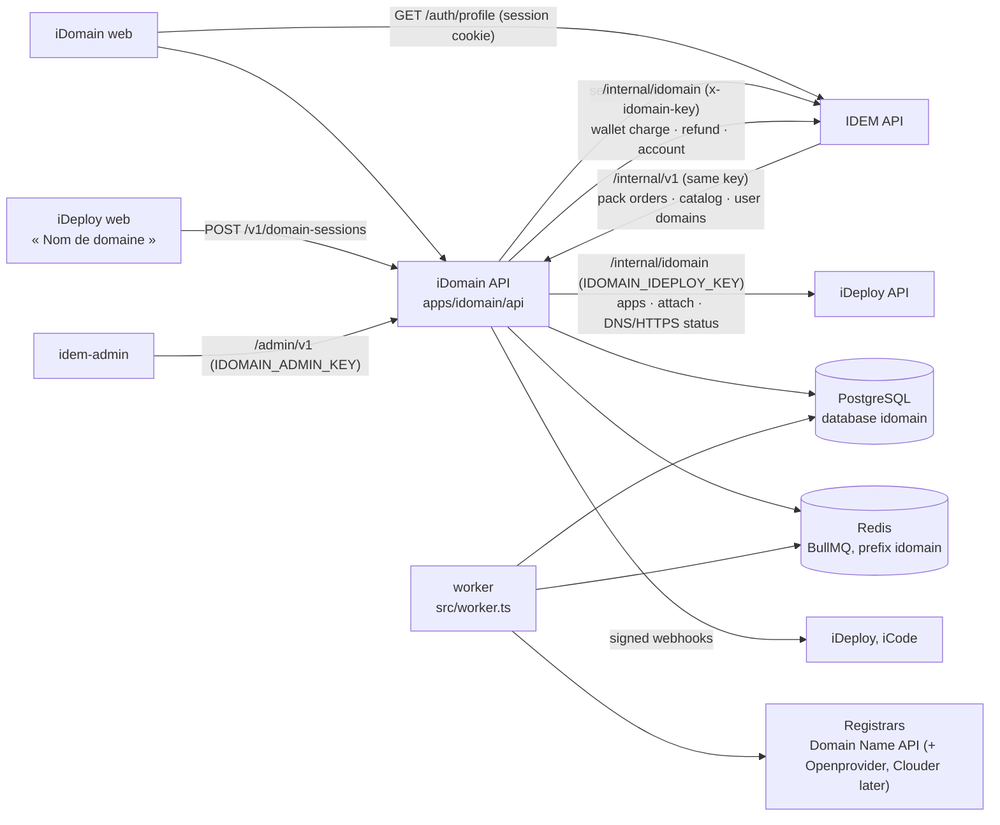

# iDomain

iDomain is the IDEM service that sells and manages **domain names**. A user finds a name, pays for it
from their IDEM wallet, and iDomain registers it, writes the DNS and connects it to their iDeploy
application with HTTPS — no technical step. It works on its own (`idomain.idem.africa`) and **inside iDeploy and iCode, without leaving them**:
the purchase window (`@idem/shared-idomain`) calls this API with the user's IDEM session, so a name is
bought, registered, written in DNS and connected to the application the user is looking at, with no
redirection and no setting to make.

```
apps/idomain/
├── api/   Express + TypeScript + PostgreSQL (raw SQL) + BullMQ — port 3007, plus a worker process
└── web/   Angular 20 — port 4205 (search and prices, checkout, my domains, DNS, connections)
```

iDomain is the **single source** of domain prices and orders. The IDEM API no longer keeps any
(`DOMAIN_PRICES` and the Mongo `domain_orders` queue were removed); it calls iDomain for the
« Pack Lancement + domaine » and relays `/billing/domains`. The admin console lives in **idem-admin**
and talks to `/admin/v1`.

## Architecture



### Identity, money and hosting come from the platform

- **Identity** — the `httpOnly` `session` cookie of the IDEM API on `.idem.africa`, checked with
  `GET /auth/profile` (cached 20 s). No sign-in screen: `{dashboard}/login?redirect=idomain&returnUrl=…`.
- **Wallet** — orders are paid from the IDEM wallet in francs (decision of 17/10/2026: mobile money only
  sells wallet top-ups). The IDEM gateway (`apps/api/api/routes/idomain.routes.ts`) is **idempotent**:
  each charge carries a reference (`idomain:order:<id>:charge`) recorded in `idomain_charges`; a replay
  never charges twice, a refund reference is honoured once and never beyond the charge. A short wallet
  answers 402 with the standard IDEM body (missing amount, suggested top-up); the order waits in
  `awaiting_payment` and is paid with `POST /v1/orders/:id/pay` after the top-up.
- **Hosting** — iDeploy already routes domains, checks public DNS, issues certificates and prevents a
  team from claiming another team's domain. iDomain does not redo any of it: its iDeploy gateway
  (`apps/ideploy-api/api/routes/idomain.routes.ts`) acts for the IDEM user after checking they belong to
  the application's team.

### Pricing engine (`api/src/modules/pricing`)

The **public price** (`public_price_catalog`, francs) never depends on the registrar. In the background,
every compatible registrar is costed at its **total cost** — extension price in its currency at the
steering rate (`fx_rates`), plus its share of the reseller membership and fixed fees — and the cheapest
**admissible** one is selected: enabled, configured, not down, capable for this TLD and operation,
name confirmed available and not premium, and the sale keeps the minimum margin:

```
margin = P × (1 − f − b) − support − total cost      admissible if margin ≥ m × P
P_min  = (total cost + support) / (1 − f − b − m)     (plan économique §9.2)
```

`f` payment fee, `b` FX cushion, `m` minimum margin, `support` per order — versioned in `pricing_rules`
and editable without redeploying. A **funded** sale (registry promotion, budget, pack or Entreprise
plan at cost) may go below the margin, never otherwise. `engine.ts` is pure and covered by
`npm run check:pricing`.

The price shown is **frozen in a price session** (30 min by default). At payment time availability and
costs are read again live, **at the agreed price**; nothing is registered before the wallet is charged.

### Order execution (`api/src/modules/orders/execution.service.ts`, worker)

1. **Reconcile** — an operation left `running` or `uncertain` (timeout after sending, killed worker) is
   checked at its registrar first: if the domain is in our account it is a success; nothing is bought twice.
2. **Revalidate** — live costs at the agreed price, registrars that refused this line excluded.
3. **Register** — idempotency key per (line, registrar). A definitive refusal moves to the next
   admissible registrar; a taken name fails the line and refunds it; an uncertain result is retried later.
4. **Conclude** — domain created (internal id, registrar reference apart), selected cost, runner-up cost
   and margin stored on the line, `domain.registered` emitted, waiting connection started.

No admissible registrar (cost went up, all down) → the line is **on hold**, retried every 15 min and
refunded after 48 h; the user may cancel and be refunded at once. Never sold at a loss.

### DNS and connection (`modules/dns`, `modules/connections`)

- The zone of a domain bought here is kept at its registrar and written **one record set at a time**
  (Domain Name API replaces a whole name + type on each write). Connecting a site writes only the `A`
  records of `@` and `www` and removes a `CNAME`/`AAAA` on those names (they would contradict it or
  break the certificate). MX, SPF, DKIM, DMARC are never touched. Every change keeps the previous values
  (`dns_changes`) and disconnecting restores them.
- A domain bought elsewhere is connected **manually**: ownership is proven with a TXT record
  (`_idem-verification.<host>`), the user gets the two values to copy, and the worker watches public DNS.
- Chain: `awaiting_domain → verifying_ownership → pending → configuring_dns → attaching → waiting_dns →
  activating_tls → active`. `active` (and the `domain.active` event) requires correct public DNS **and**
  a valid HTTPS certificate, both read by iDeploy.

### Events

`order.completed`, `order.failed`, `domain.registered`, `domain.active`, `connection.failed`, delivered
to `IDOMAIN_WEBHOOK_TARGETS` with retries. Headers `X-IDomain-Event`, `X-IDomain-Delivery` (stable across
retries, use it to deduplicate) and `X-IDomain-Signature: t=<seconds>,v1=<hex>`, where
v1 = HMAC-SHA256(`IDOMAIN_WEBHOOK_SECRET`, `<t>.<body>`).

## Inside iDeploy and iCode

The same purchase flow, one implementation (`packages/shared-idomain`, class `DomainPurchaseFlow`),
two renderings:

- **iDeploy** — « Nom de domaine » tab of an application: « Acheter un nom » opens
  `<idem-domain-purchase>` for this application; names bought with IDEM are managed in place by
  `<idem-domain-manage>` (status, expiry, renewal price, retry, disconnect, advanced DNS). The meters
  page opens the same window, where the application is chosen.
- **iCode** — publish window: once the site is online, « Choisir mon nom » opens `<DomainPurchase>`
  for the published application (`applicationUuid`, or `frontendUuid` for a full-stack app); the name
  and its state show next to the free address.

Flow: search (first-year and renewal price) → holder, asked once → price guaranteed, application
already chosen → pay from the wallet (402: top up in a new tab, then pay the same order) → the worker
registers the name, writes the `A` records, attaches it in iDeploy and waits for HTTPS. The window can
be closed; setup goes on. `npm run check:embedded --prefix apps/idomain/api` plays this flow against a
running offline API (`IDOMAIN_CHECK_API`, default `http://localhost:3007`).

In production, `IDOMAIN_ALLOWED_ORIGINS` must list the iDeploy and iCode origins
(`https://ideploy.idem.africa`, `https://appgen.idem.africa`), since their pages call this API directly.

## API

Public contract: `GET /v1/openapi.json`. Main routes (session cookie unless noted):

| Route | |
| --- | --- |
| `GET /v1/catalog`, `GET /v1/domains/search?q=` | public prices, search (no session needed) |
| `GET/PUT /v1/contact` | domain holder (required by registries before the first order) |
| `POST /v1/price-sessions` | freeze the price of a name |
| `POST /v1/orders`, `GET /v1/orders[/:id]`, `POST /v1/orders/:id/pay\|cancel` | orders (idempotency key) |
| `GET /v1/domains[/:id]`, `…/status`, `…/registrar`, `GET/POST …/dns-records` | domains, legal registrar info, DNS record sets |
| `GET /v1/applications` | the user's iDeploy applications |
| `POST /v1/domain-sessions`, `GET /v1/domain-sessions/:id` | a flow opened by iDeploy / iCode for an application |
| `POST/GET /v1/domain-connections[/:id]`, `…/retry`, `DELETE …/:id` | connect a domain to an application |
| `/internal/v1/*` (`IDOMAIN_SERVICE_KEY`) | IDEM API: catalog, prepaid pack orders, a user's domains |
| `/admin/v1/*` (`IDOMAIN_ADMIN_KEY`) | idem-admin: KPIs, prices and rules, promotions, registrars and costs, FX, orders, retries, refunds, audit, webhooks |

## Data

PostgreSQL database `idomain` (own database on the iDeploy PostgreSQL server), migrations in
`api/migrations` (node-pg-migrate, SQL). Prices are **historised**: a price change closes the active
catalog row and opens a new one; every order line keeps the catalog row, rules version, promotion,
selected registrar and cost, runner-up cost and margin. Registrar quotes are kept in
`provider_price_quotes`; sensitive actions in `audit_logs`.

Registrar credentials never leave the server: they are secrets (Infisical), the console only sees
whether a registrar is configured.

## Local development

```bash
# PostgreSQL database `idomain`, then the schema:
DATABASE_URL=postgres://idomain:<password>@localhost:5432/idomain npm run migrate:up --prefix apps/idomain/api

npm run dev:idomain-api        # API, port 3007
npm run dev:idomain-worker     # worker (orders, connections, webhooks, maintenance)
npm run dev:idomain-web        # web, port 4205
```

Without reseller credentials, set `IDOMAIN_SIMULATED_REGISTRAR=true` (refused in production): a
registrar simulated in Redis, where names starting with `pris`/`taken` are taken, `premium` are premium,
`incertain` lose their first answer after succeeding, `refuse` are refused.

Dependencies are those of the monorepo root (hoisted `node_modules`); iDomain is not in the root
workspaces (no lockfile change), like iVision.

## Checks

| Command | What it proves |
| --- | --- |
| `npm run check:pricing --prefix apps/idomain/api` | the pricing engine alone: cheapest admissible registrar, exclusions, margin floor, funded sales, multi-year costs, P_min |
| `npm run check --prefix apps/idomain/api` | the API end to end on a throwaway PostgreSQL (`IDOMAIN_CHECK_DB_URL`, migrated) and Redis db 9, with a fake IDEM and a fake iDeploy holding the gateways' contracts: search, price session, holder, 402 then payment, idempotency, registration, uncertain result reconciled, name taken before/after payment, margin hold and resume, DNS connection without touching MX/SPF, restore on disconnect, signed `domain.active`, account isolation, prepaid pack waiting for the holder, admin key |
| `npm run typecheck:idomain` | API and web |
| `npm run import:idem-orders --prefix apps/idomain/api [-- --apply]` | one-off import of the former Mongo `domain_orders` (dry run without `--apply`) |

## Configuration

Same mechanism as the other back ends (`api/src/config/secrets.ts`): `.env` then `.env.secret` locally,
the Infisical project `idomain-api` in production. Required secrets: `IDOMAIN_DB_PASSWORD`,
`IDOMAIN_SERVICE_KEY` (same value in the IDEM API), `IDOMAIN_IDEPLOY_KEY` (same value in the iDeploy API).
Optional: `IDOMAIN_ADMIN_KEY`, `IDOMAIN_WEBHOOK_SECRET`, `DNA_RESELLER_ID`, `DNA_API_KEY`, `REDIS_PASSWORD`.
`api/.env.example` lists every variable.

## Not built yet

Automatic renewals and reminders (J-30, J-15, J-7, J-1), transfers in the UI, the Openprovider and
Clouder connectors, DNS providers driven by API (Cloudflare…), the dedicated domain invoice in
`billing_invoices`, the proposal right after an iCode deployment, premium offers (DNS Premium,
monitoring, email). The data model and the registrar interface already carry renew/transfer.
